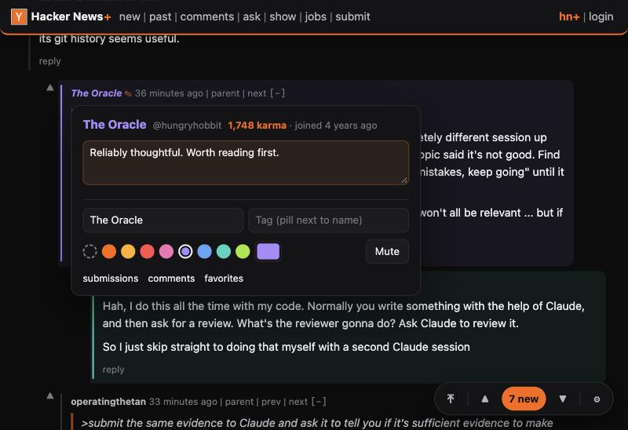
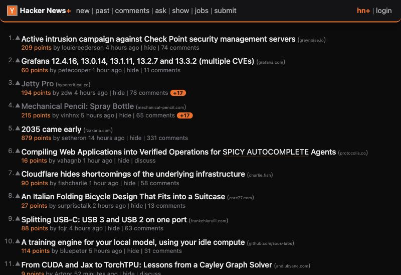
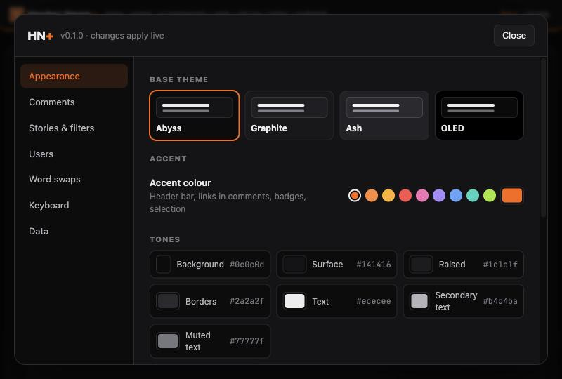

# HN+

**A dark, configurable power-user layer for Hacker News.**

HN+ is a single userscript. It gives Hacker News a deep dark theme with an accent colour you choose, plus the features a heavy reader wants: user notes and aliases, new-comment tracking, hover previews, filters and keyboard navigation.

## Install

1. Install a userscript manager: [Tampermonkey](https://www.tampermonkey.net/) or [Violentmonkey](https://violentmonkey.github.io/).
2. Open **[hn-plus.user.js](https://raw.githubusercontent.com/errorware/hn-plus/main/hn-plus.user.js)**. Your manager will offer to install it, and it updates itself from this repo after that.
3. Visit [news.ycombinator.com](https://news.ycombinator.com). Open settings with **hn+** in the header or the <kbd>,</kbd> key.

## Features

  
  

- **Theme:** four near-black bases (Abyss, Graphite, Ash, OLED). Every tone and the accent colour can be edited. It loads before the page draws, so there's no white flash.
- **Typography:** Sans, Serif, Mono ([JetBrains Mono](https://www.jetbrains.com/lp/mono/)) or classic Verdana. Text size, line height and page width are adjustable.
- **People:** hover a username for their karma and bio, plus your **private notes**. From the same card you can give them an **alias**, a tag, a highlight colour, or mute them.
- **Threads:**
  - Comments posted since your last visit are marked **NEW**, with a toolbar to jump between them.
  - Comments by the story's author get an **OP** badge.
  - Hover `parent` and `context` links to preview the comment.
  - Click the line beside a comment to collapse its thread.
  - Quotes are styled, and image links get an inline viewer.
- **Story lists:**
  - A `+N` badge shows new comments on stories you've opened, and opened stories are dimmed.
  - Filter stories by keyword, regex or domain.
  - Optional site icons.
- **Word swaps:** replace any word everywhere, for example `rust → crust`. Matching is whole-word and ignores case, and the replacement copies the original's capitalisation. Swapped words get a subtle flair: shine, glow, squiggle or marker.
- **Backup:** export and import your whole setup as JSON.

### Keyboard

| | |
| --- | --- |
| <kbd>j</kbd> <kbd>k</kbd> | next / previous story or comment |
| <kbd>J</kbd> <kbd>K</kbd> | next / previous top-level comment |
| <kbd>n</kbd> <kbd>N</kbd> | next / previous new comment |
| <kbd>x</kbd> | collapse / expand |
| <kbd>p</kbd> <kbd>r</kbd> | jump to parent / reply |
| <kbd>o</kbd> <kbd>c</kbd> | open link / open comments |
| <kbd>,</kbd> <kbd>?</kbd> | settings / shortcut list |

## Privacy

Everything you set stays in your userscript manager's local storage. Besides HN itself, the script connects only to:
- the official [HN API](https://github.com/HackerNews/API), for hover cards
- Google Fonts, for JetBrains Mono
- DuckDuckGo's icon service, only if site icons are on
- image hosts, only when you expand an image

## Development

The whole script is [`hn-plus.user.js`](hn-plus.user.js). There's no build step.

- **Live editing:** install [`dev/hn-plus.dev.user.js`](dev/hn-plus.dev.user.js) and set its `@require` path to your clone. Saved changes apply on page reload.
- **Offline testing:** `python3 dev/harness.py` serves real HN snapshots with the script injected at `localhost:8765`. Add `?demo` to a URL to load sample data.
